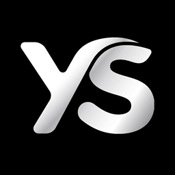

<p align="center">
  
</p>

# yorusphoto

A native Rust image editor with layers, masks, PSD support, an integrated Codex assistant and YorusAi Direct image workflows. This repository contains the yorusphoto fork of [PhotoCraft](https://github.com/storytold/photocraft), currently based on PhotoCraft 0.23.1.

## Editing with AI

- **Codex workspace:** automatic detection of your ChatGPT account, account details, switch/sign-out controls, runtime-discovered models and reasoning settings, saved chats and drafts, slash commands, messages added to a running task, reasoning and plan progress, reported context usage, compaction status, account allowances and reset times. Stable Codex runtime updates are checked automatically.
- **Animations and cutouts:** Codex can return a looping GIF of 2 to 16 frames (or, where its GIF output isn't available yet, a grid of the frames that the editor cuts apart), placed as one layer per frame or as one flipbook sheet, and transparent-background images for sprites, icons and effect textures. **Layer › Flipbook** turns frame layers into a sheet (fitted, square, or Roblox's 2×2, 4×4 and 8×8 grids) and splits a sheet back into frames.
- **Animation Preview:** an animation from Codex opens in a window where the GIF plays beside the flipbook sheet it makes, the frame on show lit in both, with play, pause, frame stepping, speed and a strip of every frame (**Layer › Flipbook › Preview Animation…** opens it for any frame layers or sheet).
- **Image references:** attach up to four PNG, JPEG or WebP images in **Codex → Images**, preview/remove them, and use them alongside the selected region or to guide a new canvas.
- **Selected-area generation:** the selected region becomes the base image reference. Results arrive on a separate layer at the captured position, preserving the source layer and any newer selection. When a result has more pixels than the selection, the whole canvas grows so every generated pixel is kept, and the layer keeps its place and size relative to the image; switch **Grow canvas to fit** off to scale the result into the selection instead.
- **Whole-image generation:** results open in a separate canvas at the requested dimensions.
- **YorusAi Direct:** native provider workflows for generation and remix (Seedream 5.5 on BytePlus, with transparent backgrounds; Nano Banana, Ideogram and FLUX on Replicate), Crystal Upscale and Seedream layer separation, using your own provider API keys. OpenAI's GPT Image API is no longer offered there; Codex's image generation through your ChatGPT account is unchanged.
- **Agent control:** an authenticated local control channel and a stdio MCP bridge expose editor commands, document inspection, screenshots and image-placement workflows.

New rectangular and elliptical selections stay within the canvas. Starting outside projects the start onto the nearest edge or corner. Fixed ratios fit inside the available canvas, so a square remains square when the pointer crosses an edge, and a Fixed Size box slides back onto the canvas instead of being cut. Holding Space moves the shape you see and stops it at the edges; the preview matches the finished selection.

Model availability and allowances come from the signed-in Codex account. Context tokens and account credits are separate measurements. API-provider access for YorusAi Direct is billed separately by the configured provider.

## Windows portable

[Download the Windows 64-bit portable release](https://github.com/yorusd1/yorusphoto/releases/latest). Under **Assets**, choose the Windows portable ZIP, extract the entire ZIP into a writable folder, and run `Start-yorusphoto.cmd`. No installation or source checkout is required. A matching SHA-256 checksum is provided.

The launcher initializes portable settings, the workspace and the local MCP configuration. Saved conversations and settings remain local. Extract upgrades into a new folder. To retain local chats and settings, close both copies and copy your existing `data/` and/or `yorusphotoData/` folders into the new portable before its first launch; keep the previous folder until you have checked your chats. The Camera Raw responsiveness and controls introduced in v8 are retained ([details](docs/camera-raw-histogram.md)). Sign in with your own ChatGPT account for Codex, or configure your own provider keys for YorusAi Direct.

Portable binaries, downloaded Codex runtimes, private settings, chat histories, credentials and local recovery copies are excluded from this Git repository. The repository contains the source, branding, packaging scripts and reusable checks.

See [the yorusphoto guide](docs/yorusphoto.md) for setup, commands, authentication, model discovery, updates and placement behavior. See [performance measurements](docs/yorusphoto-performance.md) for the v7 optimization results and their limits.

<details>
<summary>Editor tools</summary>

<h4>🧰 69 tools</h4>
      Move · Artboard · Rectangular and Elliptical Marquee · Single Row Marquee · Single Column Marquee · Lasso · Polygonal Lasso · Magnetic Lasso · Object Selection · Quick Selection · Magic Wand · Crop · Perspective Crop · Slice · Slice Select · Frame · Eyedropper · Color Sampler · Ruler · Note · Count · Remove · Spot Healing Brush · Healing Brush · Patch · Content-Aware Move · Red Eye · Brush · Pencil · Mixer Brush · Color Replacement · Clone Stamp · Pattern Stamp · History Brush · Art History Brush · Eraser · Background Eraser · Magic Eraser · Gradient · Paint Bucket · Blur · Sharpen · Smudge · Dodge · Burn · Sponge · Pen · Freeform Pen · Curvature Pen · Add Anchor Point · Delete Anchor Point · Convert Point · Horizontal and Vertical Type · Horizontal and Vertical Type Mask · Path Selection · Direct Selection · Rectangle · Ellipse · Triangle · Polygon · Star · Line · Custom Shape · Hand · Rotate View · Zoom

</details>

## Build and verify

The desktop UI uses Rust, egui/eframe and wgpu. The web target compiles the same editor to WebAssembly. Machine identifiers and crate names retain `photocraft` for compatibility.

```sh
cargo build --release -p photocraft -p photocraft-cli
cargo test -p photocraft-ui-egui --lib
cargo clippy -p photocraft-ui-egui --all-targets -- -D warnings
cargo xtask layers
cargo xtask wasm
```

See [development](docs/development.md), [architecture](docs/architecture.md) and [contributing](docs/contributing.md) for toolchains, optional dependencies and the full test gates. Windows packaging is implemented by `packaging/windows/package-yorusphoto.ps1`. The [packaging tools](scripts/yorusphoto/README.md) fetch a pinned, verified public Codex runtime and validate the portable archive.

v11 (PhotoCraft 0.23.1) passed 7,124 UI library tests (24 ignored), 3,658 engine library tests (16 ignored), 294 native app tests (3 ignored) and 85 CLI tests, built with the pinned translations and fonts as upstream's CI builds them; strict Clippy for the editor, app, engine and CLI crates and the dependency layer check passed. The packaged portable passed ten local editor/MCP checks; live checks on a connected ChatGPT account created a still image, added a message to a running chat turn, and placed a four-frame animation as frame layers (through the grid fallback, since Codex's GIF output was refused for that account). No paid provider request was made. Build logs, screenshots and private-machine verification reports remain local.

## Community

AI workflows made with yorusphoto are shared in the [YorusDevs Discord](https://discord.gg/P9zKXJdWpj); **Help › Discord** opens it from the editor. Report bugs in [Issues](https://github.com/yorusd1/yorusphoto/issues).

## License and attribution

Source code is licensed under [MIT](LICENSE-MIT) OR [Apache-2.0](LICENSE-APACHE). Existing copyright notices and [attributions](ATTRIBUTION.md) are retained. yorusphoto branding has a [separate rights notice](assets/yorusphoto/LICENSE-brand.txt). OpenAI marks identify the integrated service and are subject to their [notice](assets/yorusphoto/NOTICE-OpenAI.txt). Codex runtime distributions include their own license and notice. Provider names and trademarks belong to their respective owners.
